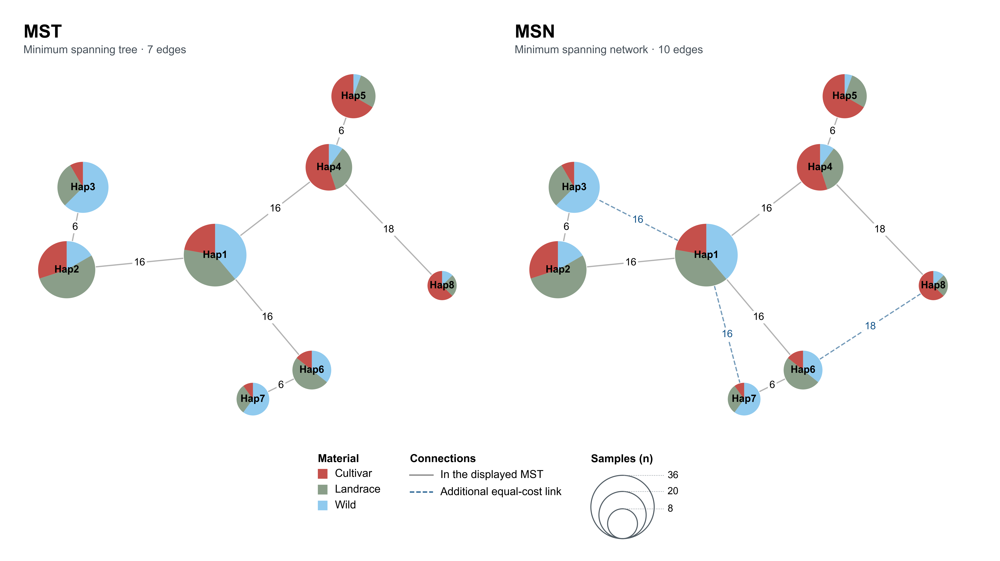

<div align="center">


**A Comprehensive Toolkit for Gene Haplotype Analysis in Natural Populations**

[](https://doi.org/10.5281/zenodo.11183815)
[](https://www.python.org/)
[](LICENSE)

[Features](#-features) • [Installation](#-installation) • [Example results](#-example-results) • [Usage](#-usage) • [Documentation](#-documentation) • [Citation](#-citation)

</div>

---

## 📖 Description

**hastat** is a powerful Python library designed for geneticists and evolutionary biologists. It streamlines the process of viewing, analyzing, and visualizing genetic variation data, specifically focusing on gene haplotypes in natural populations. From raw VCF files to publication-ready visualizations, `hastat` provides a complete workflow.

## ✨ Features

### Core Modules
| Module | Description |
|:---|:---|
| 🧬 **`view`** | Extract and analyze genotype, haplotype, $\pi$, $F_{ST}$ and Tajima's D data from VCF files. LD is available through the Python API. |
| 📊 **`stat`** | Perform robust statistical analysis (ANOVA, multiple comparisons) linking haplotypes to phenotypes. |
| 🎨 **`plot`** | Generate high-quality visualizations: Bar, Pie, Box, Network, and Gene haplotype plots. |
| 🕸️ **`network`** | Construct haplotype networks using Minimum Spanning Tree (MST) and Minimum Spanning Network (MSN). |
| 🔬 **`gwas`** | Integrated wrapper for GEMMA to perform Genome-Wide Association Studies. |

### Advanced Capabilities
- ✅ **Multi-population Analysis**: Compare haplotype frequencies and diversity across different groups.
- ✅ **Selection Signals Scan**: Detect signatures of selection using nucleotide diversity ($\pi$), fixation index ($F_{ST}$), and Tajima's D.
- ✅ **Homologous Genes Analysis**: Analyze multiple homologous genes simultaneously.
- ✅ **Customization parameters**: Flexible grouping, filtering (heterozygosity), and statistical methods.

### Comparison with Other Tools
| Feature | hastat | plink | vcftools | bcftools |
| :--- | :--- | :--- | :--- | :--- |
| **Tool Positioning** | Genotype Manipulation and Gene-centric Haplotype Analysis | Genotype Manipulation and GWAS | Genotype Manipulation and Statistics | Genotype Manipulation and Variant Calling |
| **Major Functions** | Mining Favorable Haplotypes and Breeding Improvement | Association testing, LD, Filtering | Filtering, Calc Pi/Fst | Filtering, Merging, Calling |
| **Analysis Range** | Gene and nearby regions | Whole genome | Whole genome | Whole genome |
| **Primary Input** | Genotype | Genotype | Genotype | Genotype |
| **Main Output** | Haplotype | Genotype | Genotype | Genotype |
| **Genotype fetch** | YES | YES | YES | YES |
| **Haplotype fetch** | YES | NO | NO | NO |
| **Phenotype Association** | YES | YES | NO | NO |
| **Haplotype Visuals** | YES | NO | NO | NO |
| **Multiple Species** | YES | YES | YES | YES |


### ⚠️ Limitations
`hastat` is specialized for gene-centric haplotype analysis and visualization. It is **NOT** designed for:
- **Raw Data Processing**: It does not handle FASTQ/BAM files or perform variant calling.
- **Whole-Genome Operations**: For filtering or merging VCFs, use `bcftools` or `vcftools`.
- **Complex Pedigrees**: It focuses on natural populations, not family-based linkage analysis.

## 📦 Installation

### 1. Prerequisites
> **⚠️ Windows Compatibility**: Since `pysam` is not available for Windows, `hastat` **cannot** be installed directly on Windows. Windows users are highly recommended to use **WSL (Windows Subsystem for Linux)**.

> **✅ Tested Environments**: We have tested the installation and download on **CentOS Linux 8** and **Ubuntu 24**.

- **Python 3.9+**
- **Dependencies**: `pandas`, `numpy`, `scipy`, `statsmodels`, `scikit-allel`, `gffutils`, `pysam`, `matplotlib`, `tomli`, `prettytable`, `networkx`

You can check your Python version with:
```bash
python --version
```

### 2. Download Source Code
Clone the repository from GitHub to your local machine. **Important: You must enter the `hastat` directory before installation.**
```bash
git clone https://github.com/swu1019lab/hastat.git
cd hastat
```

### 3. Install hastat
You can install `hastat` using the modern `build` system or directly with pip.

**Tip for users in China:** To speed up dependency downloading, you can use the Tsinghua PyPI mirror by adding `-i https://pypi.tuna.tsinghua.edu.cn/simple` to pip commands.

#### Option A: Using `build` (Recommended)
This method builds a standard distribution package and installs it.

1.  **Install the build tool** (skip if already installed):
    ```bash
    pip install build --user -i https://pypi.tuna.tsinghua.edu.cn/simple
    ```
2.  **Build the package**:
    ```bash
    python -m build
    ```
    *This creates a `dist/` directory containing the source archive and wheel.*
3.  **Install the package**:
    ```bash
    python -m pip install dist/hastat-2.0.0-py3-none-any.whl --user -i https://pypi.tuna.tsinghua.edu.cn/simple
    ```
    *Explanation: This installs the `hastat` library and its dependencies (pandas, numpy, etc.) into your Python environment.*

#### Option B: Install this source checkout directly
```bash
python -m pip install . --user
```

### Input table conventions

Sample and group CSVs require a header and one row per unique sample. Identifiers
and group labels are read as text: `001`, `1` and `NA` remain distinct. Surrounding
whitespace is stripped; empty identifiers/labels and duplicate IDs are rejected.
Population assignment files have exactly two columns, and every listed sample
must exist in the VCF. Phenotype tables use a `samples` column plus numeric trait
columns; missing tokens such as `NA` apply only to trait values. Network sample
joins use matched samples and warn about unmatched rows; duplicate assignments
and group indexes outside the available columns fail explicitly.

### 4. Installation Location
When using the `--user` flag (recommended to avoid permission issues):
- **Linux/macOS**: The executable `hastat` is typically placed in `~/.local/bin`.
  - *Note: You may need to add this path to your `$PATH` environment variable if `hastat` command is not found.*

To verify the installation, run:
```bash
hastat --help
```

## 🖼️ Example results

The [illustrated gallery](docs/gallery.html) shows a gene haplotype plot with
1 Mb flanks and an MST/MSN comparison built from the same eight haplotypes.
Both use 160 synthetic samples: 49 Wild, 61 Landrace and 50 Cultivar.
The [example guide](docs/EXAMPLES.md) also covers bar, pie and phenotype box plots.

### Gene haplotypes with 1 Mb flanks

One combined figure shows five CDS blocks, both 2 kb flanks, variant annotations,
48 variant columns, eight clustered haplotypes, sample counts, category colors,
population REF/ALT allele frequencies, a whole-VCF LD heatmap, three population Pi series and all three pairwise
Fst series, and Tajima's D for each material type. The gene model spans 8 kb,
including 2 kb on each side of GeneA. The three statistics tracks span
chromosome 1 from 1,000,001 to 3,004,000, with 1 Mb on each side of the gene.

`hap_file = "gene"` reads `gene.table.csv` and discovers `gene.group.csv` for
labels such as `Hap1 (n=36)`. The legend below the tree identifies the row colors
from `hap_color_file`: group1 for Hap1–3, group2 for Hap6–7, and group3 for
Hap4, Hap5 and Hap8. At the first displayed variant (1:1,998,150), only Hap2 and Hap3 carry
ALT. Counting allele copies by sample material gives 40/98 (40.8%) in Wild,
46/122 (37.7%) in Landrace and 22/100 (22.0%) in Cultivar.
Average linkage uses Hamming distances. White/dark-blue cells represent
reference/alternate homozygotes. The annotation band lines up with the variant
columns. Its colors denote categories, and selected short labels point to their
genomic positions. Each population frequency strip counts called alleles:
a heterozygote contributes one REF and one ALT. Missing genotypes contribute
neither. The LD triangle uses all VCF samples and the exact displayed variant
keys. Its width follows the matrix and its height is half that width.

```toml
ann_file = "annotations.csv"    # chrom,pos,ann and an optional short label column
pop_file = "populations.csv"    # samples,material for separate frequency strips
vcf_file = "gene.vcf.gz"        # indexed diploid genotypes for AF and LD
af_show = true                 # REF/ALT allele frequencies
ld_show = true                 # whole-population LD triangle
ld_cmap = "Blues"
ld_colorbar = true
shade_gene = true              # gray gene interval on Pi, Fst and Tajima's D
```

Without `pop_file`, one strip represents all samples. Frequencies use the VCF
when supplied, or the counts in `<prefix>.group.csv` and genotype states in the
haplotype table. Without either source the frequency track is skipped.
Filtering displayed Hap rows does not change the sample denominator.
The [recommended GeneA configuration](docs/examples/gene_tracks.toml) and
[example command](docs/examples/commands.sh) reproduce the complete figure.
From `docs/examples`, run:

```bash
hastat plot gene --gff genes.gff3 --gene GeneA --up 2000 --down 2000 --width 15 --height 17.17300419287212 --toml gene_tracks.toml -o gene_tracks.pdf
```

The command selects the gene, flanks and canvas size. The TOML sets shared track
options in `[default]`; `[GeneA]` overrides only the settings specific to GeneA.
It places Pi, Fst and Tajima's D above the gene. A single
row centered above the gene explains the annotation colors. Below the
gene, the annotation strip, haplotype matrix and REF/ALT frequencies share the
variant columns with the LD triangle at the bottom.

The gene model and statistics tracks align at the panel edges and use different
genomic scales. Matrix columns remain equally spaced. Pi/Fst/Tajima's D values are read from
existing window CSVs; the plotting command does not recalculate them.
A single `>` or `<` at the strand-direction end marks orientation. The marker
has no connecting tail, and the gene backbone ends at the gene boundary.


### MST and MSN haplotype networks

The MST connects the eight haplotypes with seven edges. The MSN adds three
equal-cost alternatives, drawn with dashed lines. Both panels use identical
node positions and use the same sample counts. Pie sectors show the Wild,
Landrace and Cultivar fractions from [synthetic material assignments](docs/examples/populations.csv).
Circle area is proportional to sample count, with a nested size legend.
Each edge label counts differing genotype states.



The [example guide](docs/EXAMPLES.md) includes exact commands, input schemas,
TOML settings, interpretation notes and editable PDF/SVG downloads.

## 🚀 Usage

The general syntax for `hastat` is:
```bash
hastat <subcommand> [options]
```

### 1. View Module (`hastat view`)
The `view` module is the core tool for extracting genetic data and calculating population genetics statistics.

#### 📍 Flexible Input Modes
`hastat` allows you to define target loci in multiple ways:
- **Single Gene**: `-i GeneID` (Requires GFF file via `-a`)
- **Genomic Region**: `-r chr:start-end` (e.g., `chr1:1000-5000`)
- **Batch List**: `-l gene_list.txt` (Process a list of gene IDs automatically)
- **Homologous Genes**: `--homo GeneA,GeneB` (Analyze multiple homologs as a single unit)

#### 📏 Region Extension & Control
You can extend the analysis scope beyond the gene body, which is crucial for analyzing promoter regions or regulatory elements.
- **`--up <int>`**: Extend $N$ bp upstream of the gene/region start.
- **`--down <int>`**: Extend $N$ bp downstream of the gene/region end.

> **Note**: These parameters apply to **all** analysis types. For example, if you calculate $F_{ST}$ with `-u 2000`, the sliding window analysis will start 2kb upstream of the gene.

#### 🧬 Analysis Types (`-t/--type`)
| Type | Description |
|:---|:---|
| `geno` | Extract raw genotype matrix (0/0, 0/1, 1/1). |
| `table` | Generate a haplotype table for samples. |
| `group` | Group samples by their haplotypes. |
| `freq` | Calculate haplotype frequencies. |
| `compare` | **Multi-Population Mode**: Compare haplotypes across multiple VCF files. |
| `pi` | Calculate Nucleotide Diversity ($\pi$). |
| `fst` | Calculate Fixation Index ($F_{ST}$). |
| `tajima_d` | Calculate Tajima's D. |

For single-VCF `table`, `group` and `freq`, all samples use the same complete
loci after the requested genotype filters. The three outputs share one
deterministic profile/rank mapping, including multi-region requests. `freq`
contains integer sample counts: `haplotypes,samples` without metadata, or
`haplotypes,<population names>` with a single header when grouped. Group files
may select a sample subset for counting; they do not redefine the profiles.
Duplicate or unknown sample assignments are rejected. Empty outputs include column headers.

#### 📊 Population Genetics ($\pi$, $F_{ST}$ & Tajima's D)

`hastat` calculates $\pi$, $F_{ST}$ and Tajima's D using a **sliding window** approach.

- **Nucleotide Diversity ($\pi$)**: Measures the average number of nucleotide differences per site between two randomly chosen sequences in a population. It reflects the genetic diversity within a population. High $\pi$ indicates high genetic diversity.
- **Fixation Index ($F_{ST}$)**: Estimates differentiation between the selected populations using Weir–Cockerham variance components. Finite-sample estimates can be negative and are retained; undefined estimates are NaN. Window estimates use a ratio of component sums, not a mean of per-SNP Fst values.
- **Tajima's D**: A test of neutrality. It compares two measures of nucleotide diversity ($\pi$ and $\theta_W$).
    - $D \approx 0$: Neutral evolution.
    - $D > 0$: Balancing selection or sudden population contraction.
    - $D < 0$: Positive selection (selective sweep) or population expansion.

- **Method**:
    1.  **Region Definition**: The total analysis region is determined by the gene coordinates plus any `--up` or `--down` extension.
    2.  **Sliding Windows**: Windows of size `--size` move across this region with a step of `--step`.
    3.  **Calculation**: Metrics are computed for each window based on sample groups provided in `-g`.
- **Required Arguments**:
    - `-g, --group`: CSV file defining sample populations (Columns: Sample, Group).
    - `-w, --size`: Window size in bp (e.g., `1000`).
    - `-s, --step`: Step size in bp (e.g., `100`).

**Example: Selection Sweep Analysis**
Calculate $F_{ST}$ for a gene and its surrounding region (extended 1MB upstream and downstream) using a sliding window approach (Reference: [Nature Genetics, 2020](https://www.nature.com/articles/s41588-020-0604-7)):
```bash
hastat view -v data.vcf.gz -a ann.gff3 -i GeneID \
    -t fst -g sample_groups.csv \
    -u 1000000 -d 1000000 --size 10000 --step 10000 -o output_prefix
```

Fst uses the same 1-based inclusive window boundaries as pi/Tajima's D. Group
assignments must refer to existing, unique samples and contain at least two
populations. Records lacking enough called individuals for the variance
components are excluded; empty or unestimable windows retain NaN. For pi/Fst/Tajima's D, use the default `--maf` and `--max_missing` settings.
The Fst CSV format is `chrom,start,end,counts,fst,groups`;
`counts` is the input variant count.

### 2. Statistics Module (`hastat stat`)
Perform statistical tests to associate haplotypes with phenotypes.
- **Input**: Haplotype groups (from `view -t group`) and Phenotype data (`-p`).
- **Methods**: `TukeyHSD` (default): classical equal-variance ANOVA plus Tukey–Kramer comparisons; `WelchBonferroni`: Welch ANOVA plus two-sided Welch t tests with Bonferroni correction.

#### Phenotype Data Format
The phenotype data file should be a CSV file with the following format:
- **First column**: Sample ID (must match sample names in haplotype group file).
- **Remaining columns**: Phenotypic traits. You can have multiple traits (columns), and each will be analyzed separately.
- **Header**: First row should contain column names (samples, trait1, trait2, ...).

**Example phenotype data (`phenotype.csv`):**
```
samples,Height,Weight,Yield,Quality
Sample_1,175.5,65.2,8500.5,7.8
Sample_2,172.3,62.8,8200.3,7.5
Sample_3,178.9,68.1,9100.2,8.1
Sample_4,170.5,61.5,7800.8,7.2
Sample_5,176.2,66.5,8900.5,8.0
```

**Usage:**
```bash
hastat stat -g hap_groups.csv -p phenotype.csv -a GeneID -o stat_results.csv
```

For Welch ANOVA and Bonferroni-corrected Welch comparisons:
```bash
hastat stat -g hap_groups.csv -p phenotype.csv -m WelchBonferroni -o stat_results.csv
```

**Tool outputs:** `-o stat_results.csv` writes only the requested full-precision
pairwise CSV table. Its fields include the method, sample counts, group means
and standard deviations, mean differences, confidence intervals, adjusted P
values, rejection decisions, omnibus P values, and comparison-family sizes.
Without `-o`, the tool prints the comparison table and omnibus records to stdout.

### 3. Visualization (`hastat plot`)
Generate high-quality visualizations for your data.

The Python LD APIs `hastat.utils.population.calculate_ld` / `calculate_multi_loci_ld`
take a `VariantData` object as their first argument and return
square r² matrices: valid diagonals are 1, undefined entries are NaN and empty
regions return (0,0). Multi-region overlaps count once. LD uses pairwise complete
diploid dosage observations with the existing Rogers-Huff implementation.
`view --type ld` is not a CLI option.

```python
from hastat.dataio.vcf import read
from hastat.utils.variant import VariantData
from hastat.utils.population import calculate_ld

with read("data.vcf.gz") as vcf:
    variants = VariantData(vcf)
    r_squared = calculate_ld(variants, "chr1", 1000, 5000)
```

For haplotype extraction, use `hastat.utils.haplotype.extract_haplotypes(variants, loci)`
to obtain the haplotype table and sample groups. Haplotype–phenotype association is
available through `hastat.utils.association.HaplotypeAssociation`:

```python
from hastat.dataio.table import read_sample_csv
from hastat.utils.association import HaplotypeAssociation

phenotypes = read_sample_csv("phenotype.csv")
groups = read_sample_csv("hap_groups.csv")
analysis = HaplotypeAssociation(phenotypes, groups, method="WelchBonferroni")
comparisons = analysis.comparisons
```

#### Common Plot Types
- **`bar` / `pie`**: Visualize haplotype frequencies in different populations.
- **`box`**: Compare phenotypic values among haplotypes or populations.
    - `TukeyHSD` and `WelchBonferroni` reuse the `stat` implementation.
      The existing default `t-test` and `mannwhitneyu` use Bonferroni-adjusted
      two-sided P values; `welch` uses `WelchBonferroni`.
    - `--comparisons` selects brackets, not the multiple-testing family.
      The family includes all eligible groups in the input, even when
      `--haplotypes` displays a subset. `--min_hap_size` defaults to 2 for plots
      (10 for `stat`); use identical inputs, method and minimum for agreement.
    - Undefined tests have no bracket; the reason is logged. `ns` is reserved
      for finite adjusted P values >= 0.05. No extra output table is created.

Box/bar/pie sample identifiers and group labels are read as text, preserving
`001`, `1`, and `NA`. Duplicate/empty IDs and duplicate headers are errors.
Input tables are joined one-to-one on shared IDs; unmatched rows are logged.
Invalid plotting input produces a nonzero CLI exit.

#### Gene Structure & Tracks (`hastat plot gene`)
Visualize the gene model along with haplotype variations and statistical tracks ($\pi$, $F_{ST}$).
- **Configuration**: Uses a TOML file to control layout, colors, and tracks.
- **Features**:
    - Plot CDS/Exon structure.
    - Align haplotype variations to the gene.
    - Display sliding window tracks for selection signatures.

**Example: Plotting Gene with Tracks**
```bash
hastat plot gene --gff ann.gff3 --gene GeneID --toml config.toml \
    --up 2000 --down 1000 -o gene_plot.pdf
```

### 4. Network Analysis (`hastat network`)
Construct and visualize haplotype networks (Minimum Spanning Tree/Network).
1.  **Generate Table**: `hastat view -t table ...`
2.  **Build Network**: `hastat network -t table.csv -o network.txt`
3.  **Visualize**: `hastat plot network --file network.txt ...`

---

### Here is a step-by-step guide based on a typical workflow

### Step 1: Generate Haplotype Table
Extract haplotypes for a specific gene from a VCF file.
```bash
hastat view \
    -t table \
    -v data.vcf.gz \
    -a annotation.gff3 \
    -i GeneID \
    -u 2000 \
    -o results/GeneID
```

### Step 2: Group Samples by Haplotype
Group samples based on their haplotypes.
```bash
hastat view \
    -t group \
    -v data.vcf.gz \
    -a annotation.gff3 \
    -i GeneID \
    -u 2000 \
    -o results/GeneID
```

### Step 3: Statistical Analysis
Perform statistical tests to associate haplotypes with phenotypes.
```bash
hastat stat \
    -g results/GeneID.group.csv \
    -p phenotype.csv \
    -a GeneID \
    -o results/GeneID.stat.csv
```

### Step 4: Visualization

#### Haplotype Frequency (Pie Chart)
```bash
hastat plot pie \
    --sample_hap results/GeneID.group.csv \
    --sample_group sample_groups.csv \
    -o results/GeneID.pie.pdf
```

#### Phenotype Distribution (Box Plot)
```bash
hastat plot box \
    --sample_hap results/GeneID.group.csv \
    --sample_phe phenotype.csv \
    --phe_index 1 \
    -o results/GeneID.box.pdf
```

#### Haplotype Network
```bash
# 1. Generate network file
hastat network -t results/GeneID.table.csv -o results/GeneID.network.txt

# 2. Plot network
hastat plot network \
    --file results/GeneID.network.txt \
    --sample_hap results/GeneID.group.csv \
    --sample_group sample_groups.csv \
    -o results/GeneID.network.pdf
```

#### Gene Structure and Selection Signals
Visualize gene structure along with $\pi$ and $F_{ST}$ tracks.
```bash
hastat plot gene \
    --gff annotation.gff3 \
    --gene GeneID \
    --toml gene.toml \
    -o results/GeneID.gene.pdf \
    --up 2000
```

### Step 5: Selection Sweep Analysis
Calculate $F_{ST}$ and $\pi$ using a sliding window approach.
```bash
# Calculate Fst
hastat view \
    -t fst \
    -v data.vcf.gz \
    -a annotation.gff3 \
    -i GeneID \
    -u 1000000 \
    -d 1000000 \
    -g sample_groups.csv \
    -o results/GeneID \
    --size 10000 \
    --step 1000

# Calculate Pi
hastat view \
    -t pi \
    -v data.vcf.gz \
    -a annotation.gff3 \
    -i GeneID \
    -u 1000000 \
    -d 1000000 \
    -g sample_groups.csv \
    -o results/GeneID \
    --size 10000 \
    --step 1000
```

## 💡 Advanced Examples

### Multi-Population Comparison
Compare haplotype frequencies between two populations (e.g., Wild and Landrace).

Inputs must use the same reference and allele representation. Compare aligns
the full chromosome/position/REF/ALT key and groups samples on loci present in
every input with complete calls across all included samples. It never treats
an absent record as a reference genotype or missing calls as a haplotype state.
The existing `population_specific` field describes input-record availability,
not proof of a biologically private allele. Outputs are unphased genotype
profiles; use `MergedHap` labels for comparison across populations.

Local numbering is deterministic (abundance, then genotype tuple descending).
Sample suffixes `_1`, `_2`, ... refer to VCF input order and must match
downstream group/phenotype files. Group CSV headers are `samples,haplotypes`.
Empty outputs include column headers. Non-default `--het`, `--maf` and
`--max_missing` settings are not supported by `compare`.

```bash
# 1. Compare haplotypes from two VCFs
hastat view -t compare \
    -v wild.vcf.gz landrace.vcf.gz \
    -n Wild Landrace \
    -i GeneID -a ann.gff3 -o comparison_result

# 2. Visualize the comparison
hastat plot bar --sample_hap comparison_result.merged.group.csv \
    --sample_group pop_info.csv -o comparison_bar.pdf
```

### Large-Scale Selection Sweep
Scan a large genomic region (e.g., 1Mb upstream/downstream) for selection signals.

```bash
hastat view -t fst \
    -v data.vcf.gz -a ann.gff3 -i GeneID \
    -u 1000000 -d 1000000 \
    -g sample_groups.csv \
    --size 100000 --step 10000 \
    -o large_scale_fst
```

## 📚 Documentation

<details>
<summary><strong>1. View Module (`hastat view`)</strong></summary>

The `view` module is the entry point for extracting and analyzing genetic data. It supports flexible input methods and various analysis types.

#### Input Modes
| Mode | Argument | Description |
|:---|:---|:---|
| **Single Gene** | `-i GeneID` | Analyze a specific gene. Requires `-a/--gff`. |
| **Region** | `-r chr:start-end` | Analyze a specific genomic region (e.g., `chr1:1000-2000`). |
| **Batch Genes** | `-l list.txt` | Analyze a list of genes provided in a file (one ID per line). Requires `-a/--gff`. |
| **Homologous** | `--homo ID1,ID2` | Analyze multiple homologous genes simultaneously. Requires `-a/--gff`. |

#### Region Control
You can extend the analysis region (e.g., to include promoters) using:
- `-u, --up <int>`: Extend $N$ bp upstream.
- `-d, --down <int>`: Extend $N$ bp downstream.

#### Analysis Types (`-t, --type`)
- **`geno`**: Extract genotype matrix.
- **`table`**: Generate haplotype table.
- **`group`**: Group samples by haplotypes.
- **`freq`**: Calculate haplotype frequencies.
- **`compare`**: Compare haplotypes across multiple populations (VCFs).
- **`pi`**: Calculate Nucleotide Diversity ($\pi$).
- **`fst`**: Calculate Fixation Index ($F_{ST}$).

#### Population Genetics Statistics ($\pi$ & $F_{ST}$)
For `pi` and `fst` analysis, `hastat` uses a sliding window approach:
- **Windowing**: Controlled by `-w/--size` (window size, default 1bp) and `-s/--step` (step size, default 1bp).
- **Grouping**: Requires a sample group file via `-g/--group` (csv: sample,group).
- **Calculation**:
    - **$\pi$**: Calculated for each group in the window.
    - **$F_{ST}$**: Calculated for all pairwise combinations of groups in the window.
    - **Region**: The analysis region is determined by the gene/region input plus any upstream/downstream extension.

**Example:** Calculate $F_{ST}$ for a gene plus 2kb upstream, using 1kb windows with 100bp step:
```bash
hastat view -v data.vcf.gz -a ann.gff3 -i GeneID -u 2000 -t fst -g groups.csv --size 1000 --step 100
```
</details>

<details>
<summary><strong>2. Statistics Module (`hastat stat`)</strong></summary>

Perform statistical tests (ANOVA, TukeyHSD).

| Argument | Description |
|:---|:---|
| `-g, --group` | Haplotype group CSV file. Required. |
| `-p, --pheno` | Phenotype CSV file. Required. |
| `-m, --method` | Method: `TukeyHSD` (default) or `WelchBonferroni`. |
| `-s, --min_hap_size` | Minimum sample size per haplotype (default: 10). |
</details>

<details>
<summary><strong>3. Network Module (`hastat network`)</strong></summary>

Construct haplotype networks.

| Argument | Description |
|:---|:---|
| `-t, --hap_table` | Haplotype table from `view -t table`. Required. |
| `-m, --method` | `MST` (Minimum Spanning Tree) or `MSN`. |
| `-o, --out` | Output file; CSV, TXT/edgelist, GEXF and GML are supported. |

`MST` returns one minimum spanning tree with deterministic tie handling. `MSN`
includes all equal-weight alternatives occurring in any minimum spanning tree.
Distances count
unequal 0/1/2 states on loci complete across all input haplotypes. Loci containing
`-1` or missing calls are excluded for every pair; no complete loci produces an
error. Zero-distance haplotypes retain their distinct names.

Single haplotypes survive export and plotting input. Network CSV uses the
`source,target,weight,type` columns: an isolated node uses `type=node`
with empty target and weight. TXT stores an isolated node as a `#node` comment
understood by hastat; use GEXF/GML when another application must retain it.
</details>

<details>
<summary><strong>4. Plot Module (`hastat plot`)</strong></summary>

Visualize results. Subcommands: `bar`, `pie`, `box`, `network`, `gene`.

**Common Arguments:**
- `-o, --output`: Output file path.
- `--width`, `--height`: Figure dimensions.

**Subcommand Specifics:**
- **`bar` / `pie`**: Requires `--sample_hap`, `--sample_group`.
- **`box`**: Requires `--sample_hap`, `--sample_phe`, `--comparisons`.
- **`network`**: Pass one network file to `--file`. Weighted Kamada–Kawai is the default layout.
- **`gene`**: Requires `--gff`, `--gene`, `--toml` and `-o`. Set flanks with `--up` and `--down`, and canvas dimensions with `--width` and `--height`.

**Gene Plot Configuration (`gene.toml`):**
Control the appearance of gene structure plots using a TOML file.

Each call draws one gene. Settings in `[default]` apply to every gene. The section matching
`--gene` overrides those defaults for that gene. Unknown parameters produce a warning and are skipped.

Paths inside this TOML are relative to the TOML file's directory (absolute paths
are also accepted). A specified missing or unreadable file causes an error.
Pi/Fst tracks accept the existing `view` CSV outputs, preserve literal chromosome
and group labels, show single-window values as points, and retain NaN gaps and
negative Fst estimates.

| Parameter | Type | Description | Default |
|:---|:---|:---|:---|
| **Panel layout** | | | |
| `layout` | string | `fixed` uses the bbox-relative track positions, independently of the input files. Choose `auto` to stack tracks without specifying window, AF or LD Y positions. | `"fixed"` |
| `bbox` | list | Panel bounds `[x, y, width, height]`. All tracks span its full width. | `[0.1, 0.1, 0.8, 0.8]` |
| **Gene structure** | | | |
| `gene_y` | float | Vertical center of the gene within the panel. | `0.5` |
| `gene_height` | float | Gene height relative to bbox. | `0.2` |
| `gene_color` | string | Gene color. | `"C1"` |
| `gene_feature` | string | Feature to plot (e.g., "CDS", "exon"). | `"CDS"` |
| `gene_label_show` | bool | Whether to show gene name label. | `true` |
| `gene_label_size` | int | Font size for gene label. | `10` |
| **Annotation** | | | |
| `ann_file` | string | Annotation CSV with chrom,pos,ann and optional label. Include ref and alt together for allele-specific annotations. | `""` |
| `ann_y` | float | Optional first label row relative to the gene bbox. | automatic |
| `ann_band_y` | float | Bottom of the annotation strip relative to the bbox. | above matrix |
| `ann_legend_y` | float | Bottom of the annotation legend relative to the bbox. | above callouts |
| `ann_text_size` | int | Font size for annotation text. | `8` |
| **Haplotypes** | | | |
| `hap_file` | string | Input prefix: reads `<prefix>.table.csv` and automatically uses `<prefix>.group.csv` for sample counts if present. An explicit `.table.csv` path is also accepted. | `""` |
| `hap_y` | float | Y position for haplotype matrix relative to bbox. | `0.0` |
| `hap_height` | float | Height of haplotype matrix relative to bbox. | `0.3` |
| `hap_cols` | list | List of specific haplotypes to show (empty for all). | `[]` |
| `hap_label_show` | bool | Whether to show haplotype labels. | `true` |
| `hap_label_size` | int | Font size for haplotype labels. | `8` |
| `hap_count_show` | bool | Show assigned sample counts as `Hap1 (n=25)` when the matching `.group.csv` exists. | `true` when `.group.csv` exists |
| **Haplotype Groups** | | | |
| `hap_color_file` | string | Optional headerless CSV: haplotype, category. The row colors and lower-left legend identify the categories of displayed haplotypes. | `""` |
| `hap_group_bar_x` | float | X position offset for group bar. | `-0.12` |
| `hap_group_bar_width` | float | Width of group bar. | `0.02` |
| `hap_cluster_show` | bool | Show a Hamming-distance hierarchical tree; missing loci are excluded consistently across displayed haplotypes. | `false` |
| `hap_cluster_linkage` | string | `average`, `complete`, `single` or `weighted`. Ward/centroid/median are incompatible with this distance. | `"average"` |
| `af_show` | bool | Draw per-site REF/ALT allele frequencies. | `true` |
| `pop_file` | string | Optional two-column sample/population CSV for allele frequency tracks. | `""` |
| `vcf_file` | string | Indexed diploid VCF for allele frequencies and LD. | `""` |
| `ld_show` | bool | Draw the whole-population LD triangle using `vcf_file`. Its height is half its physical width. | `false` |
| `ld_y` | float | Top of the downward LD triangle relative to the bbox, in fixed layout. | below AF or matrix |
| `ld_cmap` | string | Matplotlib colormap for r², on a fixed 0–1 scale. Undefined pairs are gray. | `"Blues"` |
| `ld_colorbar` | bool | Show the LD color scale. | `true` |
| `shade_gene` | bool | Shade the annotated gene interval on Pi, Fst and Tajima's D tracks. | `false` |
| `af_height` | float | Height of each frequency track. | `0.05` |
| `af_y` | float | Bottom of the frequency strips relative to the bbox, in fixed layout. | `0` |
| `af_style` | string | Plot type: `"bar"` or `"pie"`. | `"bar"` |
| **Tracks (Pi/Fst/Tajima's D)** | | | |
| `pi_file` | string | Path to Pi data CSV file. | `""` |
| `pi_y` | float | Bottom of the Pi plot relative to the bbox. | `0.55` |
| `pi_height` | float | Height of Pi plot. | `0.2` |
| `pi_style` | string | Plot style: `"line"` or `"fill"`. | `"fill"` |
| `fst_file` | string | Path to Fst data CSV file. | `""` |
| `fst_y` | float | Y position for Fst plot. | `0.8` |
| `fst_height` | float | Height of Fst plot. | `0.2` |
| `fst_style` | string | Plot style: `"line"` or `"fill"`. | `"fill"` |
| `tajima_d_file` | string | Path to the Tajima's D window CSV. | `""` |
| `tajima_d_y` | float | Y position for the Tajima's D plot. | `0.3` |
| `tajima_d_height` | float | Height of the Tajima's D plot. | `0.2` |
| `tajima_d_style` | string | Plot style: `"line"` or `"fill"`. | `"fill"` |

```toml
[default]
# Example configuration
bbox = [0.1, 0.1, 0.8, 0.8]
gene_color = "C1"
gene_label_show = true
hap_file = "gene"
pi_file = "pi.csv"
```

The prefix above reads `gene.table.csv`; if `gene.group.csv` exists, sample counts
are added automatically. If it is absent, labels show names only. Generate both
files with the same region, samples and filters. Counts refer to unique assigned
samples, not SNPs or chromosome copies, and stay with their names after selection
and clustering. A present but malformed/mismatched group file is an error, even
when counts are hidden. `hap_count_show=false` hides counts. `hap_color_file` accepts a headerless
category file such as `Hap1,A` / `Hap2,B`.

Clustering uses average linkage by default on Hamming distances across common
complete loci. Singletons remain visible, two haplotypes form a one-branch tree,
and tied distances are resolved from a stable ID order. Missing calls do not form
a genotype category. No shared complete locus or an incompatible method causes
an explicit error.

Gene features, annotation targets and SNP connections use the gene and its
requested flanks. Each Pi, Fst or Tajima's D track displays every window for
the gene's chromosome in its CSV, from the smallest start to the largest end.
If the CSV omits `chrom`, all rows are treated as windows on the gene's chromosome.
The tracks align at the panel edges even when their genomic ranges differ.
Coordinates increase left to right on both strands; the strand arrow
indicates transcription direction. GFF feature lengths are inclusive, so a
single-base feature remains visible. Haplotype matrix columns remain equally
spaced; their connectors map back to physical positions.
</details>

<details>
<summary><strong>5. GWAS Module (`hastat gwas`)</strong></summary>

Run GWAS using GEMMA.

| Argument | Description |
|:---|:---|
| `-c, --config` | Configuration TOML file. Required. |
</details>

---

## 📄 Citation

If you use **hastat** in your research, please cite:
> **Xiaodong Li, Yuhong Wang, Boyu Meng, Zhixuan Qin, Minghao Zhang, Jiaming Song, Kun Lu**, Hastat: Mining Favorable Haplotypes of Trait-Associated Genes for Breeding Improvement in Natural Populations, *Horticulture Research*, 2026;, uhag018, https://doi.org/10.1093/hr/uhag018
