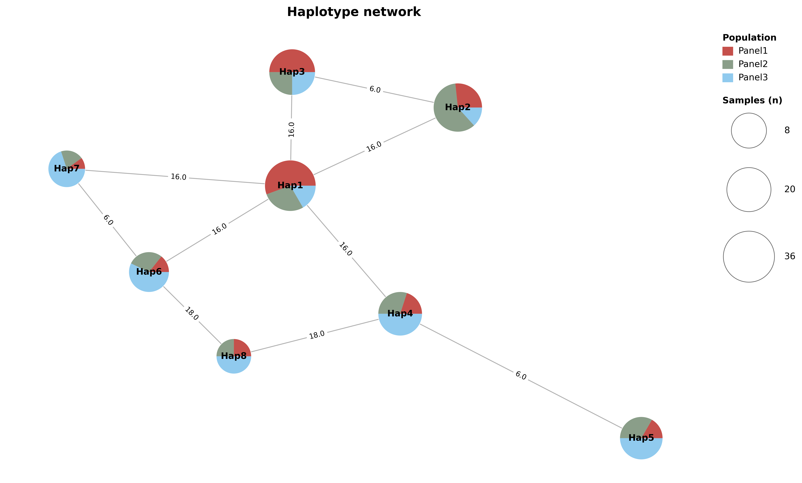

# Complete graphical examples

One complete example is shown for each plot type: bar, pie, box, network and
gene. All five use the same **160 synthetic samples, eight haplotypes and
48 variants**. Panel1/Panel2/Panel3 contain 52/54/54 samples; Hap1–Hap8 contain
36/30/24/20/18/14/10/8. Trait values and Pi/Fst estimates are illustrative.

After installing this development version, run from the repository root:

    bash docs/examples/commands.sh

The script creates five PDFs in docs/images. The [illustrated gallery](gallery.html)
shows the exact individual commands. Its supplied figures also have editable
PDF/SVG and 600 dpi PNG exports.

All ordinary `hastat plot` exports also embed TrueType fonts in PDF
(`pdf.fonttype=42`) and preserve text elements in SVG (`svg.fonttype=none`).
No additional option is required. For text editing in Adobe Illustrator, install
the fonts used by the plot or substitute available fonts. The supplied examples
use DejaVu Sans, included with Matplotlib. Text and font structures are verified;
editing inside Illustrator itself has not been tested. Equations or rotated
labels may import as multiple text objects.

## Inputs

| File | Contents |
|:---|:---|
| [gene.table.csv](examples/gene.table.csv) | chrom,pos,ref,alt followed by eight haplotype genotype-state columns; 48 rows. |
| [gene.group.csv](examples/gene.group.csv) | Unique samples,haplotypes assignments; supplies sample counts. |
| [populations.csv](examples/populations.csv) | Unique samples,population assignments for three populations. |
| [phenotypes.csv](examples/phenotypes.csv) | samples,Trait numerical observations. |
| [genes.gff3](examples/genes.gff3) | GeneA, chromosome 1, bases 2501–6500, plus strand and five CDS blocks. |
| [hap_colors.csv](examples/hap_colors.csv) | Headerless haplotype/category pairs; ClassA: Hap1–3, ClassB: Hap4–5, ClassC: Hap6–8. |
| [annotations.csv](examples/annotations.csv) | chrom,pos,ann labels at selected upstream, coding and downstream sites. |
| [gene.pi.csv](examples/gene.pi.csv), [gene.fst.csv](examples/gene.fst.csv) | Forty 200 bp windows per series, over bases 501–8500; three Pi populations and three pairwise Fst series. |
| [gene_tracks.toml](examples/gene_tracks.toml) | Complete gene-plot configuration, including frequency and window tracks. |
| [gene.network.csv](examples/gene.network.csv) | MSN edges generated from the same 48-variant table. |

Coordinates are 1-based inclusive. This complete example uses homozygous states
0 (reference) and 2 (alternate); the tool also recognizes 1 (heterozygous) and -1
(missing). Synthetic sample identifiers are demonstration labels.

## 1. Population sample counts

Stack segments are counts of matched samples assigned to each haplotype.
For relative composition, add --calc_percentage and use --y_label Fraction:
that option returns values between 0 and 1.
[PDF](images/bar.pdf) · [SVG](images/bar.svg)

## 2. Population composition

Each population has its own pie, with the matched sample total below it.
Haplotype colors are shared with the bar plot.
[PDF](images/pie.pdf) · [SVG](images/pie.svg)

## 3. Trait distributions and comparisons

Points show observations; boxes show medians and interquartile ranges.
Whiskers extend to the most extreme observations within 1.5 interquartile ranges.
The three displayed comparisons use Tukey-adjusted P values from the full
eight-haplotype family (28 pairwise comparisons), even though only three
brackets are requested. Symbols: *** < 0.001, ** < 0.01, * < 0.05, ns ≥ 0.05.
TukeyHSD assumes independent observations, approximately normal within-group
errors and common within-group variance.
[PDF](images/box.pdf) · [SVG](images/box.svg)

## 4. Complete haplotype network

Eight labeled nodes show all three population compositions. Marker area follows
the tool's square-root scaling of sample count; the size legend is in sample
counts. Edges are hidden beneath nodes, including translucent pie sectors.
The network uses the same group palette as the Pi curves, with opaque sectors
in this example. The external Samples (n) legend shows 8, 20 and 36 samples;
circle sizes exactly match the corresponding node sizes, with separated labels.
Edge numbers count unequal genotype states across common complete sites.
MSN retains all minimum-spanning alternatives, which can include tied routes.
The layout does not imply ancestry, evolutionary time or geographic distance.
[PDF](images/network.pdf) · [SVG](images/network.svg)

## 5. Complete gene haplotype figure

Read from top to bottom:

1. Annotations and five CDS blocks across a 4 kb gene with 2 kb on each side.
   The strand line lies below the feature blocks; visible arrowheads in the gaps
   show direction. A separate direction marker covers single-feature genes.
2. A 48-column variant matrix, eight haplotype labels with sample counts,
   category colors and average-linkage clustering.
3. Three REF/ALT proportion strips for ClassA/B/C. Blue means reference and
   coral means alternate. These count distinct haplotype profiles in each
   category, without weighting by the sample counts in the row labels.
4. Pi for three populations, followed by all three pairwise Fst series.
   Both use existing 200 bp window estimates. Pi is displayed in units of 10⁻³.

The file prefix requires gene.table.csv and discovers optional gene.group.csv.
When the group file is absent, labels omit sample counts. hap_color_file
separately controls the category strip. All paths in the TOML are relative to
that TOML file.

Clustering uses average linkage on Hamming distances over common complete loci.
It describes profile similarity, not a phylogeny or a significance test.
The 4 kb gene occupies 50.0% of the 8 kb interval. Genomic features, annotations,
variant endpoints and window midpoints share physical coordinates; matrix
columns stay equally spaced.

The plot reads existing Pi/Fst CSV values. For biological analyses, generate
corresponding windows using hastat view -t pi and hastat view -t fst over the
same region and populations.
[PDF](images/gene_tracks.pdf) · [SVG](images/gene_tracks.svg)

Public inputs, commands and figures are user documentation. Tests, developer
validation code, parser caches, logs and QA reports are kept separately and
excluded from both release distribution formats.

