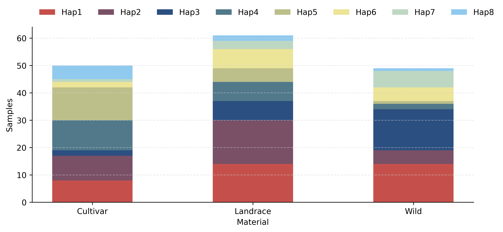
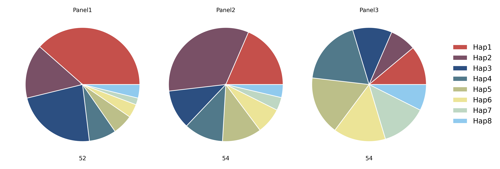
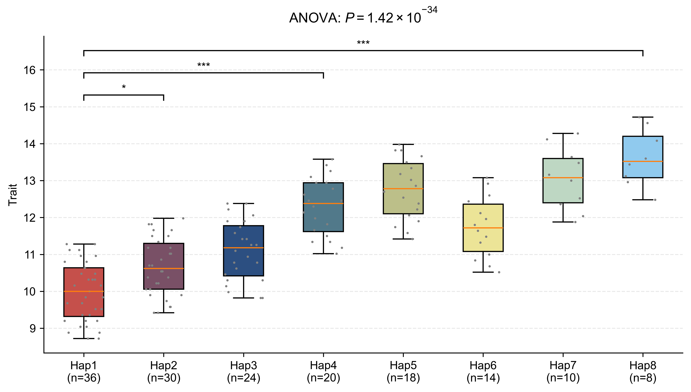
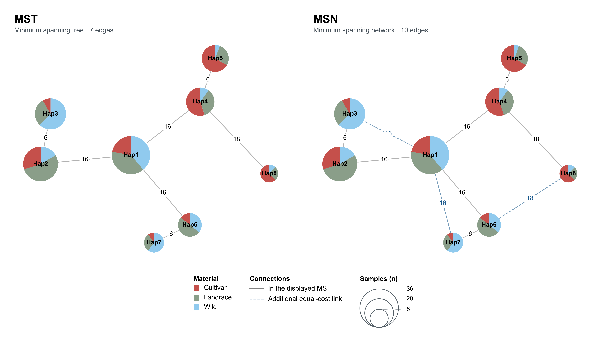

# Complete graphical examples

These five examples use **160 synthetic samples, eight haplotypes and 48
displayed variants**, with Wild, Landrace and Cultivar population assignments.
Browse the figures in the [gallery](gallery.html).

After installing hastat, run from the repository root:

    bash docs/examples/commands.sh

The script creates `docs/images/gene_tracks.pdf`, `docs/images/mst.png`
and `docs/images/msn.png`.
Run the tutorial commands below from `docs/examples`.

## Inputs

| File | Contents |
|:---|:---|
| [gene.table.csv](examples/gene.table.csv) | chrom,pos,ref,alt followed by eight haplotype genotype-state columns; 48 rows. |
| [gene.group.csv](examples/gene.group.csv) | Unique samples,haplotypes assignments; supplies sample counts. |
| [populations.csv](examples/populations.csv) | Sample ID and material type (Wild, Landrace or Cultivar). Used for network pies, allele frequencies, window statistics, and bar and pie counts. |
| [phenotypes.csv](examples/phenotypes.csv) | samples,Trait numerical observations. |
| [genes.gff3](examples/genes.gff3) | GeneA, chromosome 1, bases 2,000,001–2,004,000, plus strand and five CDS blocks. |
| [hap_colors.csv](examples/hap_colors.csv) | Haplotype row colors: group1 contains Hap1–3, group2 contains Hap6–7, and group3 contains Hap4, Hap5 and Hap8. The CSV has no header. |
| [annotations.csv](examples/annotations.csv) | Positions and categories for the 48 plotted variants, with optional labels on two CDS sites. |
| [gene.pi.csv](examples/gene.pi.csv), [gene.fst.csv](examples/gene.fst.csv) | 41 windows from 1,000,001 to 3,004,000 per series: π for each material type and Fst for each pair of types. Window size and step are both 50 kb. |
| [gene.vcf](examples/gene.vcf) | Diploid genotypes for all 160 samples, including the 48 displayed variants and additional flanking sites used in the statistics tracks. |
| [gene.vcf.gz](examples/gene.vcf.gz) and [its tabix index](examples/gene.vcf.gz.tbi) | Indexed copy used directly by the gene figure. |
| [gene.tajima_d.csv](examples/gene.tajima_d.csv) | Tajima's D for the three material types, using the same 41 windows as π and Fst. The last window is clipped at 3,004,000. |
| [gene_tracks.toml](examples/gene_tracks.toml) | Complete gene-plot configuration, including frequency and window tracks. |
| [gene.mst.csv](examples/gene.mst.csv), [gene.msn.csv](examples/gene.msn.csv) | MST and MSN edges generated from the same 48-variant table. |

Coordinates are 1-based inclusive. The 48-site haplotype matrix uses homozygous states
0 (reference) and 2 (alternate); the tool also recognizes 1 (heterozygous) and -1
(missing).

## 1. Population sample counts



```bash
hastat plot bar --sample_hap gene.group.csv --sample_group populations.csv --x_label Material --y_label Samples --width 10 --height 4 -o ../images/bar.png
```

Bars show haplotype sample counts within each population.
For relative composition, add `--calc_percentage` and use `--y_label Fraction`:
that option returns values between 0 and 1.
[PDF](images/bar.pdf) · [SVG](images/bar.svg)

## 2. Population composition



```bash
hastat plot pie --sample_hap gene.group.csv --sample_group populations.csv --width 11 --height 4 -o ../images/pie.png
```

Pies show haplotype proportions and sample totals for each population.
[PDF](images/pie.pdf) · [SVG](images/pie.svg)

## 3. Trait distributions and comparisons



```bash
hastat plot box --sample_hap gene.group.csv --sample_phe phenotypes.csv --method TukeyHSD --comparisons Hap1 Hap2 --comparisons Hap1 Hap4 --comparisons Hap1 Hap8 --width 10 --height 5 -o ../images/box.png
```

Points show observations; boxes show medians and interquartile ranges. Labels include effective sample counts, and the overall test P value is shown above the plot. Use `--x_rotation 45` to rotate labels.
Whiskers extend to the most extreme observations within 1.5 interquartile ranges.
The three displayed comparisons use Tukey-adjusted P values from the full
eight-haplotype family (28 pairwise comparisons). `--comparisons` selects the
pairs to display. Symbols: *** < 0.001, ** < 0.01, * < 0.05, ns ≥ 0.05.
TukeyHSD assumes independent observations, approximately normal within-group
errors and common within-group variance.
[PDF](images/box.pdf) · [SVG](images/box.svg)

## 4. Minimum spanning tree and network



Generate both networks from the haplotype table, then draw each network with
the same sample and population assignments:

```bash
hastat network -t gene.table.csv -m MST -o gene.mst.csv
hastat network -t gene.table.csv -m MSN -o gene.msn.csv
hastat plot network --file gene.mst.csv --sample_hap gene.group.csv --sample_group populations.csv --show_node_label --node_label_size 8.3 --show_edge_label --edge_label_size 8.4 --node_alpha 1 --width 6 --height 6 -o ../images/mst.png
hastat plot network --file gene.msn.csv --sample_hap gene.group.csv --sample_group populations.csv --show_node_label --node_label_size 8.3 --show_edge_label --edge_label_size 8.4 --node_alpha 1 --width 6 --height 6 -o ../images/msn.png
```

`--show_node_label` displays haplotype names; `--show_edge_label` displays
genotype difference counts. Use `--edge_label_symbol "|"` for tick marks and
`--edge_label_size` to adjust their size.

The MST has seven edges. The MSN adds three equal-cost alternatives, shown as
dashed lines. Node area represents sample count; pie sectors show population
composition. Counts use matched samples with valid population assignments.
[PDF](images/mst_msn.pdf) · [SVG](images/mst_msn.svg)

## 5. Gene haplotypes with 1 Mb flanks


Use the [recommended GeneA TOML](examples/gene_tracks.toml) with the supplied
[example inputs](examples/), including the indexed VCF. The three statistics
CSVs are supplied with the example. To calculate them from the same VCF and
population assignments, run:

```bash
hastat view -v gene.vcf.gz -r 1:1000001-3004000 -g populations.csv -t pi --size 50000 --step 50000 -o gene
hastat view -v gene.vcf.gz -r 1:1000001-3004000 -g populations.csv -t fst --size 50000 --step 50000 -o gene
hastat view -v gene.vcf.gz -r 1:1000001-3004000 -g populations.csv -t tajima_d --size 50000 --step 50000 -o gene
```

Draw the complete figure using those CSVs and the recommended configuration:

```bash
hastat plot gene --gff genes.gff3 --gene GeneA --up 2000 --down 2000 --width 15 --height 17.17300419287212 --toml gene_tracks.toml -o ../images/gene_tracks.png
```

`[default]` supplies shared settings; `[GeneA]` overrides them for this gene.
Paths are relative to the TOML file. See the [TOML reference](index.html#gene-config)
for all configuration options.

The gene view includes 2 kb flanks. Statistics tracks use the supplied 50 kb
windows spanning 1 Mb flanks. Pi is displayed in units of 10⁻³; undefined
estimates appear as gaps. `shade_gene = true` marks the gene interval.

`hap_file = "gene"` reads `gene.table.csv` and optionally `gene.group.csv` for
sample counts. `hap_color_file` assigns haplotype color categories.
`ann_file` supplies variant annotations, with an optional `label` column.

AF uses called alleles from `vcf_file`, grouped by `pop_file`. LD is calculated
from all VCF samples for the displayed variants. Set `ld_show = false` to hide
LD; `ld_cmap` and `ld_colorbar` control its palette and color scale.
[PDF](images/gene_tracks.pdf) · [SVG](images/gene_tracks.svg)


